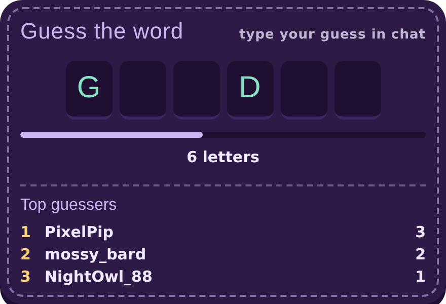
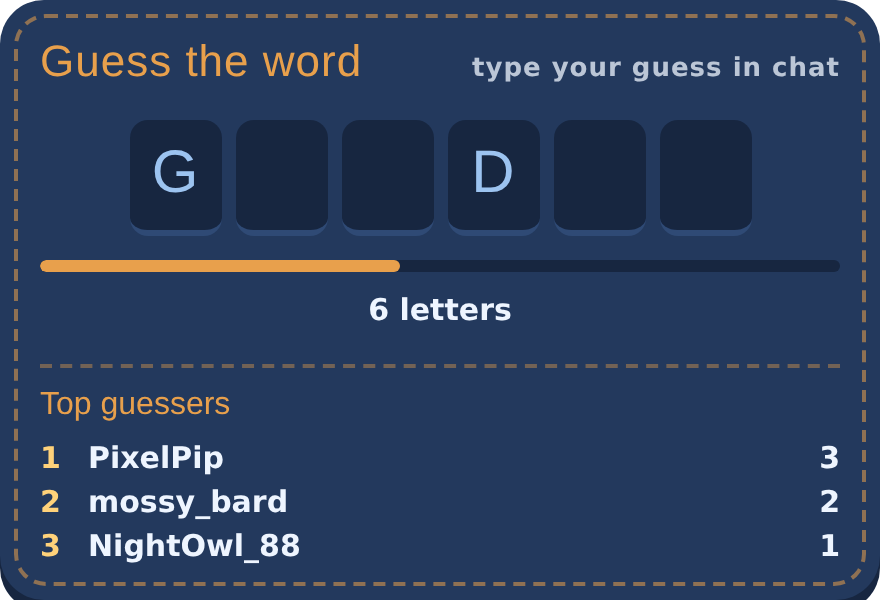
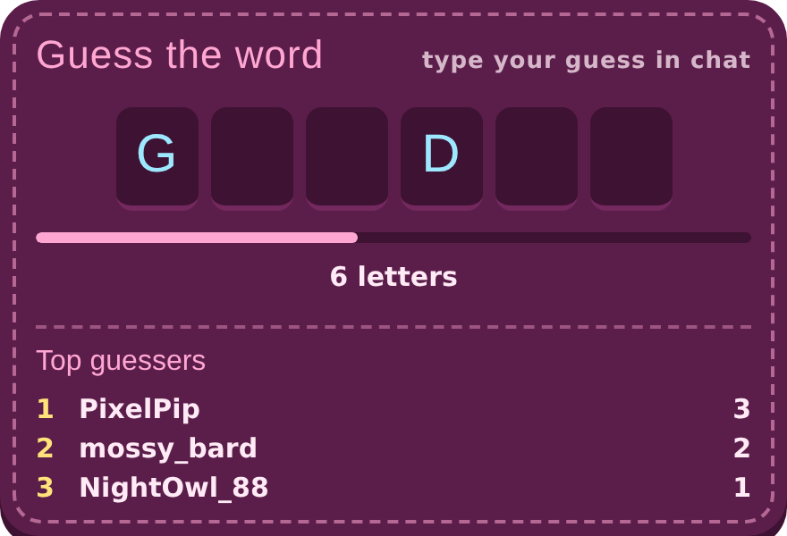
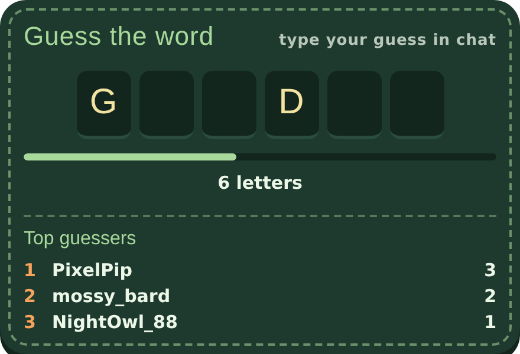
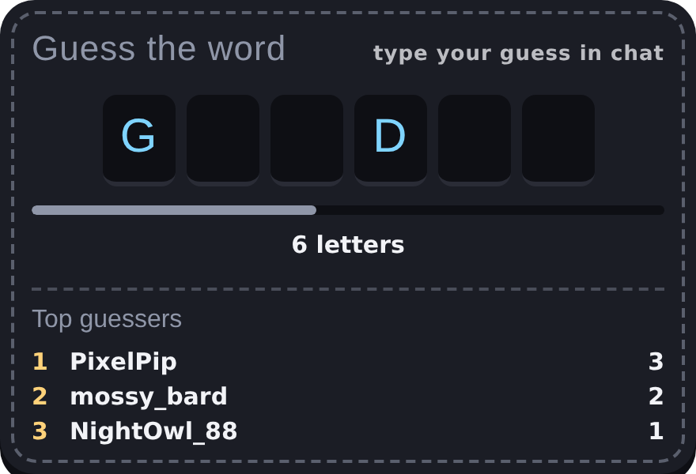
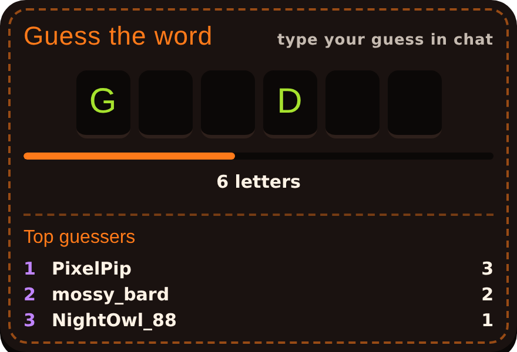
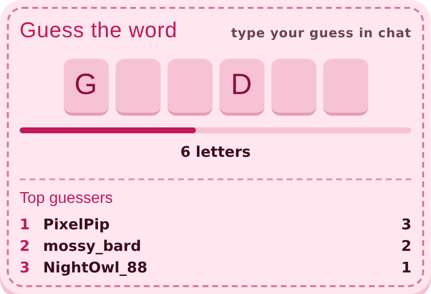
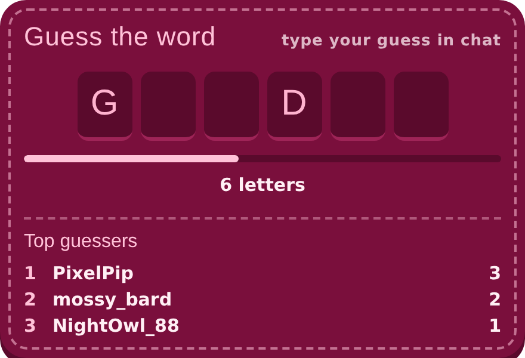

# Word Scramble

A hands-off Twitch chat word guessing game for OBS. Viewers type guesses in chat whenever they like, and the first correct guess wins the round.

- Each word starts with one random letter showing.
- More letters can appear on a timer, but the last letter is never revealed.
- The winner goes on the on-screen leaderboard, and the next word starts a few seconds later.
- No commands, mods, or streamer involvement are needed once it's running.

## Contents

- [Requirements](#requirements)
- [Step 1: Save the file and set your channel](#step-1-save-the-file-and-set-your-channel)
- [Step 2: Add it to OBS](#step-2-add-it-to-obs)
- [Step 3: Set up your word list (optional)](#step-3-set-up-your-word-list-optional)
- [Step 4: Choose the look and game options](#step-4-choose-the-look-and-game-options)
- [Step 5: Connect a chat bot (optional)](#step-5-connect-a-chat-bot-optional)
  - [Firebot](#firebot)
  - [Streamer.bot](#streamerbot)
  - [Mix It Up](#mix-it-up)
- [Troubleshooting](#troubleshooting)

## Requirements

- **OBS Studio**, or another streaming app that supports browser sources
- **The Word Scramble game file**, the `.html` file in this repository
- **A text editor** such as Notepad (Windows), TextEdit in plain text mode (Mac), or VS Code
- **A Google account** (optional), for your own live word list
- **Firebot, Streamer.bot, or Mix It Up** (optional), for chat announcements, sounds, or points

## Step 1: Save the file and set your channel

Download the game file and put it in a folder you won't move, such as `Documents/Stream Overlays/Word Scramble`. OBS loads it from that location every time.

1. Open the game file in your text editor (right-click it, then **Open with**). Don't double-click it, since that opens it in a web browser instead.
2. Find the **SETTINGS** section near the top of the script.
3. Change `CHANNEL` to your Twitch channel name, in lowercase, between the quotes:
   ```js
   const CHANNEL = "yourchannel";
   ```
4. Add any bot accounts to `IGNORE_USERS` so they can never win. Names go in lowercase, in quotes, separated by commas.
5. Save the file.

The other settings in that section are optional:

| Setting | What it does | Default |
| --- | --- | --- |
| `REVEAL_EVERY_SEC` | Starting seconds between letter reveals (the gear menu can change it later) | `45` |
| `PAUSE_BETWEEN_WORDS_SEC` | How long the answer stays up after a win | `8` |
| `LEADERBOARD_SIZE` | How many names the leaderboard shows | `5` |
| `WORDS_SHEET_URL` | Your Google Sheet link ([Step 3](#step-3-set-up-your-word-list-optional)) | empty |
| `SHEET_CHECK_EVERY_SEC` | How often the sheet is checked for changes | `60` |
| `FIREBOT_PRESET_LIST_ID` | Your Firebot preset list ID ([Firebot](#firebot)) | empty |
| `STREAMERBOT_ACTION_NAME` | Your Streamer.bot action's name ([Streamer.bot](#streamerbot)) | empty |
| `STREAMERBOT_WS` | Streamer.bot WebSocket Server address | `ws://127.0.0.1:8080/` |
| `STREAMERBOT_PASSWORD` | Only if WebSocket authentication is on in Streamer.bot | empty |
| `MIXITUP_COMMAND_ID` | Your Mix It Up command ID ([Mix It Up](#mix-it-up)) | empty |

The game reads chat without logging in, so you never need to enter a password or token.

## Step 2: Add it to OBS

1. In OBS, click **+** under Sources and choose **Browser**. Name it "Word Scramble."
2. Check **Local file**, click **Browse**, and select the game file.
3. Set **Width** to `1000` and **Height** to `700`. This leaves room for the Large size, the Wide bar layout, and the gear menu. Empty space is transparent.
4. **Uncheck** "Shutdown source when not visible." If it stays checked, hiding the source stops the game and guesses made while it's hidden are missed.
5. Click **OK**, then drag and resize the game where you want it in your scene.

Within a few seconds the overlay shows a word with one letter. If it says "Connecting to chat" for longer than that, see [Troubleshooting](#troubleshooting).

> [!TIP]
> After editing the file later, open the source's Properties and click **Refresh cache of current page** so OBS loads your changes.

## Step 3: Set up your word list (optional)

Out of the box, the game uses its built-in list of about 100 everyday words. Making your own list in a Google Sheet lets you pick themed words, and you or a mod can change them from any device mid-stream without reloading anything.

### Create the sheet

1. Go to [sheets.google.com](https://sheets.google.com) and create a blank spreadsheet. Give it a name like "Word Scramble Words."
2. Type **Words** in cell A1 as a header. It's skipped by the game.
3. Starting in A2, type one word per cell going down **column A**. Leave the other columns empty.

### Publish it and connect it

1. Go to **File > Share > Publish to web**.
2. Pick your sheet tab, choose **Comma-separated values (.csv)**, and click **Publish**.
3. Copy the link it shows.
4. In the game file, paste that link between the quotes in `WORDS_SHEET_URL`, save, and refresh the browser source.

### Choosing words

- Only single words made of the letters A to Z are used. Phrases, hyphens, apostrophes, and numbers are skipped, because chat guesses are matched one word at a time.
- Words of 5 to 10 letters tend to play best. Very short words get guessed instantly.
- Avoid words people type in normal chat (like "hello" or "stream"), or someone may win by accident.
- A themed list works well, for example a holiday, a season, or a game you play on stream. Aim for at least 50 words so repeats are rare.
- If you later have a list saved as a `.csv` file, you can load it with **File > Import > Upload**, then choose **Replace current sheet**.

### How updates work

The game checks the sheet every 60 seconds and uses new words starting with the next round. Google can take a few minutes to publish your edits, so changes aren't always instant. If the sheet can't be reached, the game uses the last copy it loaded, or the built-in list if it has never loaded the sheet.

> [!IMPORTANT]
> Keep the published link private. Anyone with it can see every upcoming answer. To let a mod add words, share the sheet with them as an editor instead.

## Step 4: Choose the look and game options

All display and game options are set from a gear menu on the overlay, and every choice is saved between streams.

1. Make sure the Word Scramble source is **visible** (eye icon on). A hidden source shows nothing in Interact.
2. Right-click the source and choose **Interact**.
3. Move your mouse over the overlay. A gear appears in its top-right corner. Click it.
4. Tap the options you want; they change right away. Click **Done** when finished.

The gear only appears while your mouse is over the overlay in the Interact window, so viewers normally never see it.

| Option | Choices |
| --- | --- |
| Color | Lavender, Denim, Bubblegum, Forest, Midnight, Halloween, Rose, Dark Rose ([previews](#color-themes)) |
| Size | Small, Medium, Large |
| Layout | Tall panel, or Wide bar with the leaderboard beside the word |
| Leaderboard | Show or Hide |
| Reveal letters over time | On, or Off (only the starting letter shows) |
| Seconds between reveals | 5 to 600; use − and + or type a number (shown only when reveals are on) |
| Scrambled letters hint | Show or Hide a row of the word's letters in mixed-up order |
| Reset leaderboard | Click twice to confirm |

The menu also shows which word list is in use, how many words it has, and when the sheet was last checked.

### Color themes

All previews show the Medium size and Tall panel layout. Light themes like Rose stand out most on dark game footage; dark themes blend in more quietly.

| | |
| :---: | :---: |
|  |  |
| **Lavender** | **Denim** |
|  |  |
| **Bubblegum** | **Forest** |
|  |  |
| **Midnight** | **Halloween** |
|  |  |
| **Rose** | **Dark Rose** |

## Step 5: Connect a chat bot (optional)

The game can only read chat, so a bot handles anything that posts in chat, plays a sound, or awards points. When someone wins, the game sends your bot three pieces of information: the winner's name, the word, and the winner's total wins.

Set up whichever bot you use; you can leave the others blank. The bot must be running for this to work, but the game itself works fine without one.

### Firebot

**Create the preset effect list**

1. In Firebot, go to **Preset Effect Lists** and create a new one named "Word Scramble."
2. Under **Arguments**, click **+** three times and name them exactly `username`, `word`, and `wins`.
3. Add an effect such as **Chat** with a message like:
   ```
   $presetListArg[username] got it! The word was $presetListArg[word].
   ```
4. Leave Run Mode on **Sequential (All)** and click **Save**.
5. Reopen the list and expand **How to trigger from Stream Deck**. Copy only the ID at the end of the URL shown, after `/preset/`.
6. Paste that ID between the quotes in `FIREBOT_PRESET_LIST_ID`, save, and refresh the browser source.

**Keep a leaderboard in Firebot (optional)**

1. Go to **Currency** and create one, such as "Word Scramble Wins."
2. Set the payout amounts to **0**, and set **Limit** to a large number like `100000`. A limit of 0 blocks every point.
3. In the Word Scramble preset list, add an **Update Currency** effect: choose the currency, Operation **Add**, Target **Single User**, Username `$presetListArg[username]`, Amount **1**.

**To reset both leaderboards:** use **Reset leaderboard** in the gear menu, then run a one-time Update Currency effect in Firebot set to **Set**, **All Viewers**, Amount **0**.

### Streamer.bot

**Turn on the WebSocket Server**

1. In Streamer.bot, open the **Servers/Clients** tab and choose **WebSocket Server**.
2. Check **Auto Start**, then click **Start Server**. Leave the address `127.0.0.1`, port `8080`, and endpoint `/` unless you have changed them.
3. If you turned on authentication there, put the same password in `STREAMERBOT_PASSWORD`. Otherwise leave it blank.

If you use a different address or port, update `STREAMERBOT_WS` to match, for example `ws://127.0.0.1:8081/`.

**Create the action**

1. Open the **Actions** tab, right-click the actions list, and choose **Add**. Name it "Word Scramble Win."
2. In the sub-actions area, right-click and add what you want to happen. For a chat message, choose **Twitch > Chat > Send Message to Channel** with a message like:
   ```
   %username% got it! The word was %word%. That's %wins% wins!
   ```
3. Leave the action without a trigger; the game runs it directly.
4. In the game file, put the action's exact name between the quotes in `STREAMERBOT_ACTION_NAME`, save, and refresh the browser source.

The name must match exactly, including capital letters and spaces. Inside the action, the arguments `%username%`, `%word%`, and `%wins%` are available to any sub-action.

### Mix It Up

**Turn on the Developer API**

1. In Mix It Up, open the **Services** page.
2. Scroll to **Developer API** and click **Connect**.

**Create the command**

1. Go to **Commands > Action Groups** and create a new one named "Word Scramble Win."
2. Add a **Chat** action with a message like:
   ```
   $arg1text got it! The word was $arg2text. That's $arg3text wins!
   ```
3. Save the action group.

**Find the command ID**

1. With Mix It Up running, open this address in your web browser:
   ```
   http://localhost:8911/api/v2/commands?pageSize=500
   ```
2. Press **Ctrl+F** (or **Cmd+F** on Mac) and search for "Word Scramble Win."
3. Copy the `ID` value that belongs to it. It's a long code with dashes.
4. In the game file, paste that ID between the quotes in `MIXITUP_COMMAND_ID`, save, and refresh the browser source.

Inside the command, `$arg1text` is the winner, `$arg2text` is the word, and `$arg3text` is the winner's total wins.

**Award points (optional):** add a **Consumables** action to the action group that adds 1 of your chosen currency to a specific user, using `$arg1text` as the username.

## Troubleshooting

| Problem | Fix |
| --- | --- |
| Says "Set CHANNEL at the top of this file" | `CHANNEL` is still the placeholder. Set it in [Step 1](#step-1-save-the-file-and-set-your-channel) and refresh the source. |
| Stuck on "Connecting to chat" | Check the channel name spelling (lowercase, no `#`) and your internet connection, then refresh the source. |
| Correct guesses don't count | Make sure the guesser isn't in `IGNORE_USERS`. The word must appear as its own word in the message. |
| Changes to the file don't show | Properties > **Refresh cache of current page**. |
| Can't find the gear | Turn the source's visibility on, open **Interact**, and hover over the overlay's top-right corner. |
| Bottom of the gear menu is cut off | Make the browser source at least 700 pixels tall. |
| Your sheet words aren't used | Check that the link is the **Publish to web** CSV link, not the normal sheet link. Wait a few minutes for Google to publish edits. |
| The gear menu says "last copy, sheet not reachable" | Google couldn't be reached; the game keeps using the last list it loaded and retries every 60 seconds. |
| Firebot effects never run | Firebot must be running. Check the preset ID has no extra spaces, then test the list with its play button. |
| Streamer.bot action never runs | Check the WebSocket Server is started and the action name matches exactly. If authentication is on, check `STREAMERBOT_PASSWORD`. |
| Mix It Up command never runs | Check the Developer API is connected on the Services page and the ID was copied in full. |
| Chat message works but currency doesn't | In the Currency settings, set **Limit** above 0. In the effect, check Amount is 1 and the right currency is picked. |
| A new word starts every time the source is shown again | Uncheck "Shutdown source when not visible" so the game keeps running while hidden. The leaderboard is saved either way. |
